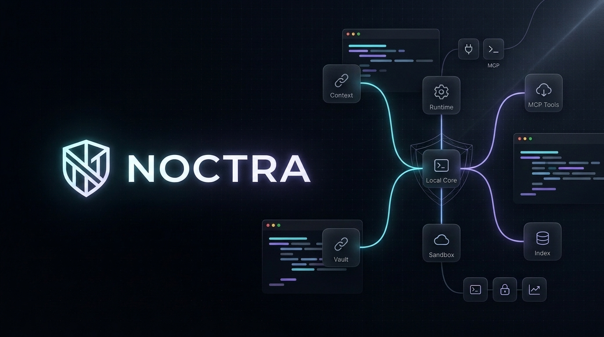

<p align="center">
  
</p>

# NOCTRA

> **"YOUR AI. YOUR RULES. YOUR OWN ECOSYSTEM."**
>
> *Powerful AI experiences. Private by design. Built around you.*

**NOCTRA** is a privacy-first, local-first AI ecosystem built around user ownership, direct provider connectivity, and zero developer telemetry.

---

## Repository Structure

```text
noctra/
├── android/     # NOCTRA AI — Privacy-first Android AI chat app (Flutter & Dart)
├── assets/      # Brand & README media assets
├── desktop/     # NOCTRA STUDIO — Desktop AI agent, MCP & workflow platform (Tauri 2, Rust, React)
└── web-ui/      # NOCTRA Official Website, Download Center & MDX Docs (Next.js App Router)
```

---

## Products & Subprojects

### 1. NOCTRA AI (`android/`)

A privacy-first Android AI chat application built with **Flutter** and **Dart**.

- **OpenAI-Compatible Connectivity**: Direct `POST /chat/completions` (SSE streaming) and `GET /models` connections to cloud endpoints or local servers (Ollama, LM Studio).
- **Local-First Storage**: Conversations, system prompts, AI personas, and prompt templates are stored locally in Hive boxes.
- **Hardware-Backed Credentials**: API keys are stored exclusively in Android Keystore via `FlutterSecureStorage` and redacted from JSON/Markdown exports.
- **On-Device Attachment Processing**: Local extraction for images (`JPG`, `JPEG`, `PNG`, `WEBP`), documents (`PDF`, `DOCX`, `XLSX`, `PPTX`), and data/code files (`TXT`, `MD`, `JSON`, `CSV`).
- **Privacy Controls**: Zero analytics SDKs, zero ad trackers, optional biometric lock (`local_auth`), and explicit transmission controls.

See [`android/README.md`](android/README.md) for architecture and build commands.

### 2. NOCTRA STUDIO (`desktop/`)

A desktop AI agent, MCP, Skills, and workflow orchestration platform built with **Tauri 2**, **Rust**, **React**, **TypeScript**, and **SQLite**.

- **Multi-Provider AI Engine**: OpenAI-compatible HTTP + SSE client with incremental `tool_calls` assembly and local attachment processing.
- **MCP Hub (`2025-03-26`)**: Native JSON-RPC 2.0 client supporting `stdio` (filtered child environments) and `Streamable HTTP`, strict `jsonschema` input validation, and unified Tool Explorer.
- **Agent Builder & Multi-Agent Runtime**: Scoped models, directory path containment, execution limits (`maxSteps`, `maxToolCalls`, `maxRuntimeSecs`, `maxAgentDepth`), and isolated agent memory.
- **Skills Center & GitHub Inspector**: `SKILL.md` YAML frontmatter + Markdown authoring, local/ZIP import, and pre-install GitHub repository inspection (external skills are flagged `unverified` by default; `scripts/` are never auto-executed).
- **Visual Workflow Engine**: Pausable, cancellable DAG workflow execution with `Approval` gates and persisted SQLite run history.
- **Internet Mode & Security Scanner**: Opt-in per-conversation TCP port scanning, DNS lookup, HTTP/HTTPS security header audits, and safe URL fetching with SSRF/allowlist guardrails.
- **SSH Server Automation**: Pure-Rust async SSH client (`russh`) with OS Keychain credential storage, TOFU host key verification, interactive command runner, and built-in AI server automation tools (`ssh_exec`, `ssh_read_file`, `ssh_write_file`, `ssh_list_dir`, `ssh_system_info`).
- **Browser Automation (`/browser`)**: Explicit slash-command web automation triggered directly in chat (`/browser <URL> [task]`) with persistent per-conversation browser sessions, interactive UI element detection, clicking, typing, form filling/submission, scrolling, data extraction, CAPTCHA/login barrier alerts, and mandatory user confirmation for sensitive actions.
- **Security & OS Keyring**: Secrets stored in Windows Credential Manager, macOS Keychain, or Linux Secret Service via `keyring`, with `SecretRedactor` log scrubbing.

See [`desktop/README.md`](desktop/README.md), [`desktop/docs/ARCHITECTURE.md`](desktop/docs/ARCHITECTURE.md), and [`desktop/docs/SECURITY.md`](desktop/docs/SECURITY.md).

### 3. NOCTRA Official Website (`web-ui/`)

The official product showcase, Download Center, MDX Documentation system, and Changelog built with **Next.js (App Router)**, **React**, **TypeScript**, **Tailwind CSS v4**, and **Framer Motion**.

- Centralized product metadata (`data/products/`), release manifests (`data/releases/`), and environment-driven links (`data/site-config.ts`).
- Categorized MDX documentation (`content/docs/`) with search, Table of Contents, code copy buttons, and Prev/Next pagination.
- SEO metadata, Open Graph cards, JSON-LD structured data, `sitemap.xml`, and `robots.txt`.

See [`web-ui/README.md`](web-ui/README.md) for setup and Vercel deployment instructions.

---

## Quick Start

### NOCTRA AI (`android/`)
```bash
cd android
flutter pub get
flutter test
flutter build apk --release
```

### NOCTRA STUDIO (`desktop/`)
```bash
cd desktop
npm install
npm run typecheck
npm test
npm run tauri dev
```

### NOCTRA Web UI (`web-ui/`)
```bash
cd web-ui
npm install
npm run dev
```

---

## Privacy & Transmission Transparency

NOCTRA clients operate without mandatory user accounts, developer telemetry, or advertising trackers. When you send prompts or attachments to an external AI provider, remote Streamable HTTP MCP server, or fetch a GitHub Skill, relevant payloads are transmitted directly from your device to those configured endpoints under their respective policies.

---

## Releases

Pre-release build artifacts are published on [GitHub Releases](https://github.com/hieuphampm/Noctra/releases).

---

## Contributing

Contributions, bug reports, and security reviews are welcome! Please read [`CONTRIBUTING.md`](CONTRIBUTING.md) for development setup, architectural/security guidelines, and Pull Request conventions.

---

## License

See [`LICENSE.md`](LICENSE.md) for license terms.
